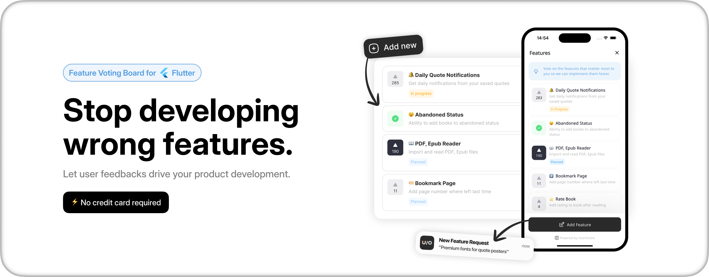

# [UserOrient](https://userorient.com)

[](https://pub.dev/packages/userorient_flutter)

**Feature voting board for Flutter apps.**

Let your users vote on what to build next. Collect feedback, prioritize your roadmap, ship what matters.

<!-- TODO: replace with the board GIF -->
<p align="center">
  
</p>

## Quick start

**1.** Add the package.

```yaml
dependencies:
  userorient_flutter: <latest-version>
```

**2.** Configure it once at startup, with the API key from your [dashboard](https://app.userorient.com).

```dart
import 'package:userorient_flutter/userorient_flutter.dart';

void main() {
  UserOrient.configure(apiKey: 'YOUR_API_KEY');
  runApp(MyApp());
}
```

**3.** Open the board.

```dart
UserOrient.openBoard(context);
```

That's it. Your users can now vote, comment and suggest features.

## How it looks

- **Fits your app.** It uses your app's font and follows its light or dark mode.
- **Native on every platform.** A sheet on phones, a side panel on web and desktop.
- **One entry point.** Users suggest features from inside the board, so they see what's already there before adding a duplicate.
- **Reviewed before it's public.** New suggestions go to you first until you accept and publish it.

## Options

Everything except `apiKey` is optional.

```dart
UserOrient.configure(
  apiKey: 'YOUR_API_KEY',

  // Colors the primary button and the voted state.
  accentColor: Colors.blue,

  // Used in dark mode. Falls back to accentColor.
  darkAccentColor: Colors.lightBlueAccent,

  // Board language. Defaults to English.
  language: Language.en,

  // Asks for an email when a feature is suggested.
  //   required     — must be entered before sending
  //   optional     — can be skipped (default)
  //   notCollected — the step is skipped entirely
  collectEmail: CollectionMode.optional,

  // Phone model, OS version and your app version.
  collectMetadata: CollectionMode.optional,

  // Shows "Powered by UserOrient" even on a paid plan.
  // Free plans always show it.
  keepWatermark: true,
);
```

Text on top of the accent color is picked automatically, so it stays readable whatever you pass. Backgrounds, dividers and the rest are fixed, so they never clash with each other.

## Identify users

Tell UserOrient who the user is, so their votes are still there next time.

```dart
UserOrient.identify(
  // Your own user ID.
  id: '123456',

  // Shown on their comments.
  name: 'Kamran Bekirov',

  // Used for follow-ups on their suggestions. If you pass it, the email step is skipped.
  email: 'kamran@userorient.com',

  phoneNumber: '+994501234567',

  // Lets you see which votes came from paying customers.
  isPaying: true,

  // Anything else you want to save about them.
  extra: {
    'plan': 'pro', 
    'seats': 4,
  },
);
```

Every field is optional. Skip them all and the user stays anonymous, but their votes are still remembered on that device.

When someone signs out, forget them so the next person doesn't inherit their votes:

```dart
await UserOrient.logout();
```

## Languages

`az` `de` `en` `es` `fr` `it` `tr` `ru` `ar` `uk` `zh`

```dart
// Turns a locale string into a Language. Unknown ones become English.
Language.fromCode('en-US'); // Language.en
```

## Contact

- Email: [kamran@userorient.com](mailto:kamran@userorient.com)
- Twitter: [@userorient](https://twitter.com/userorient)
